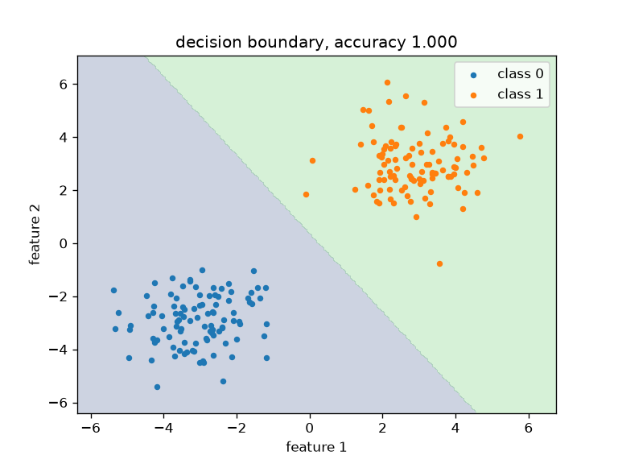
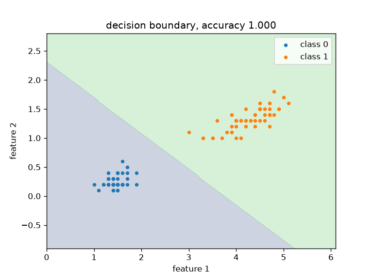
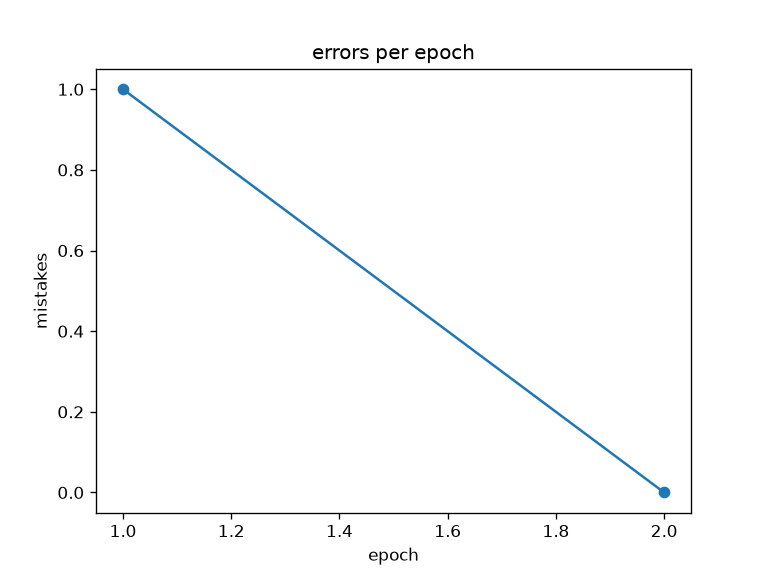
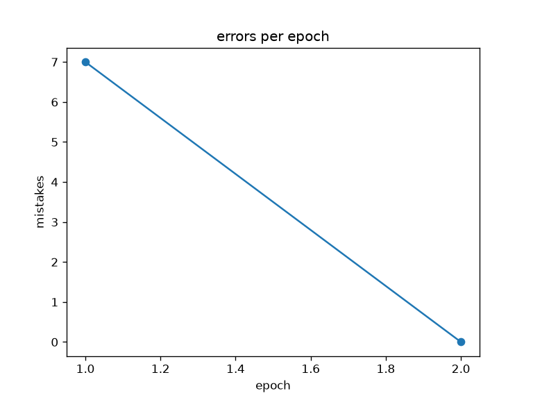

# Perceptron


Программа генерирует два облака точек на плоскости, обучает перцептрон их разделять,
печатает точность на обучающей и тестовой выборках и строит графики. Дополнительно
модель проверяется на реальном датасете iris.

## Как работает перцептрон

1. Взвешенная сумма признаков: `z = w · x + b`.
2. Пороговая активация: класс `1`, если `z >= 0`, иначе `0`.
3. Обучение: для каждой точки `w += lr · (target − pred) · x` и `b += lr · (target − pred)`.
   Веса меняются только там, где модель ошиблась.
4. Остановка: если эпоха прошла без единой ошибки, дальнейшее обучение ничего не изменит,
   и цикл прерывается раньше заданного числа эпох.

Граница решения — прямая `w1·x1 + w2·x2 + b = 0`. Если классы линейно разделимы,
правило обучения гарантированно находит разделяющую прямую за конечное число шагов.
На графике эта прямая не вычисляется по формуле: вся плоскость признаков закрашивается
по предсказаниям модели, и линия проявляется как стык двух цветов.

## Установка

Нужны [uv](https://docs.astral.sh/uv/) и Python 3.12+.

```bash
git clone https://github.com/Hdd167/perceptron.git
cd perceptron
uv sync
```

## Запуск

```bash
uv run perceptron --samples 200 --lr 0.1 --epochs 50
```

```
Dataset: clusters, samples: 200
Trained for 2 epochs, errors in the last epoch: 0
Accuracy train: 1.000
Accuracy test:  1.000
Close the plot windows to finish.
```

Тот же CLI запускается и через сам файл: `uv run python src/perceptron/cli.py --samples 200`.

### Аргументы

| Аргумент | По умолчанию | Описание |
|---|---|---|
| `--dataset` | `clusters` | `clusters` или `iris` |
| `--samples` | `200` | число точек (только `clusters`) |
| `--lr` | `0.1` | скорость обучения |
| `--epochs` | `50` | максимальное число эпох |
| `--seed` | `0` | зерно генератора и разбиения на выборки |
| `--figures DIR` | — | папка для сохранения графиков PNG |
| `--show / --no-show` | `--show` | открывать окна графиков |

Справка: `uv run perceptron --help`.

### Примеры

```bash
# окна графиков и PNG в папку figures/
uv run perceptron --samples 200 --figures figures

# только точность в терминале, без окон (для скриптов и серверов)
uv run perceptron --no-show --samples 200 --figures figures

# реальные данные: iris, два класса по двум признакам лепестка
uv run perceptron --no-show --dataset iris --seed 42 --epochs 100
```

## Графики

| Синтетические кластеры | Iris |
|---|---|
|  |  |
|  |  |

Слева два гауссовых облака, разнесённых на расстояние 3: перцептрон сходится за
2 эпохи, ошибок в последней эпохе нет. Справа тот же алгоритм на iris — точность
100% на обеих выборках. Имена файлов собираются из датасета, поэтому запуски на
кластерах и на iris не перетирают друг друга.

## Проверка на iris

Из четырёх признаков берутся два (длина и ширина лепестка) и два класса
(setosa против versicolor), данные перемешиваются и делятся 80/20.

| Датасет | Классы | Признаки | Train | Test |
|---|---|---|---|---|
| `clusters` | два облака | 2 | 1.000 | 1.000 |
| `iris` | setosa против versicolor | 2 | 1.000 | 1.000 |

Setosa отделена от верзиколора очень чётко, поэтому одной прямой хватает.
Добавить третий вид нельзя: versicolor и virginica в пространстве признаков
перекрываются, а линейная модель разделить их не может — точность застряла бы
около 0.7, а число ошибок колебалось бы вместо падения к нулю. Это ограничение
модели, а не реализации.

## Тесты и проверки

```bash
uv run pytest                 # 15 тестов
uv run ruff check             # линтер
uv run ruff format --check    # форматирование
uv run mypy --strict src tests # проверка типов
```

Тесты покрывают пороговую активацию, предсказание на известных весах, обучение на
разделимых данных, валидацию входных данных, генерацию кластеров, срез iris и
сохранение графиков. Всё это прогоняется в GitHub Actions на каждый push
(`.github/workflows/ci.yml`) вместе с дымовым запуском CLI.

## Структура

```
src/perceptron/
├── model.py   # класс Perceptron: activate, predict, predict_batch, train, score
├── data.py    # синтетические кластеры, срез iris, разбиение train/test
├── plots.py   # граница решения и график ошибок: build / save / show
└── cli.py     # аргументы командной строки и запуск
tests/         # pytest: модель, данные, графики
figures/       # графики для README
```
